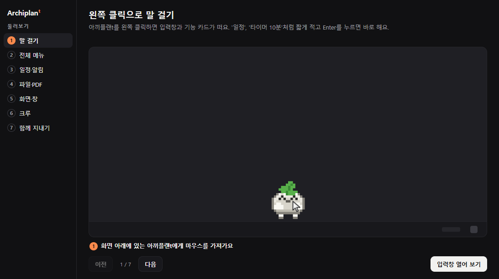
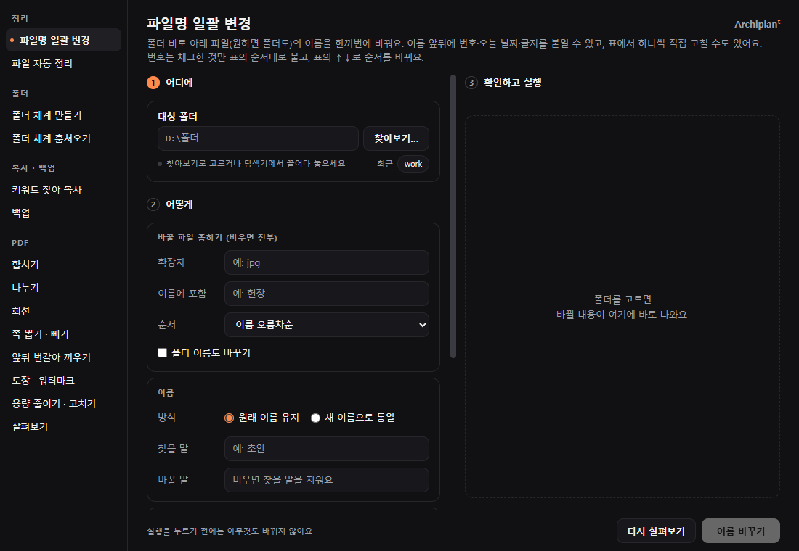
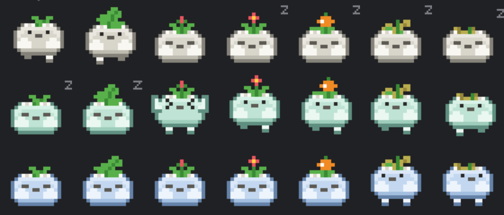
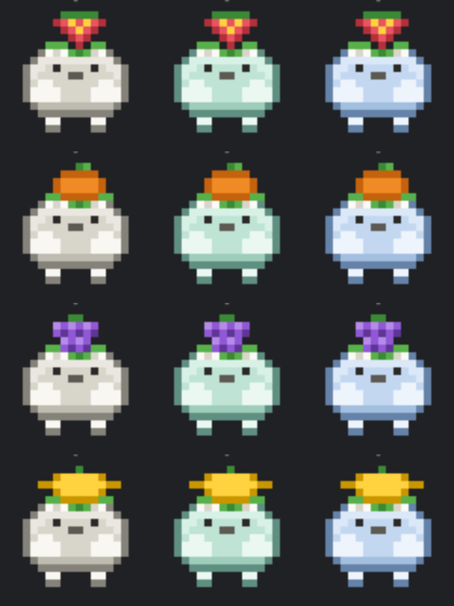

# Archiplant

아끼플랜t(Archiplant). 예전 이름은 클로미(Clomi)입니다. 설치 파일·설치 폴더·Windows 앱 목록의 이름은 아직 Clomi입니다.

화면 아래에서 지내는 Windows용 작은 화분 비서 펫입니다. 일정 알림, 알람, 메모·타이머, 파일·PDF 정리, PC 점검, 창 정리를 도와줍니다. AI 서비스에 연결하지 않고, 정해 둔 말과 단추만으로 모든 기능이 동작합니다.

개인이 만든 무료 프로그램이며 Google, Microsoft와 관계가 없습니다. [이용 조건](LICENSE.md) · [개인정보 처리 안내](PRIVACY.md) · [오픈소스 고지](THIRD_PARTY_NOTICES.md)

## 화면

처음 켜면 나오는 둘러보기입니다. 펫을 왼쪽 클릭하고 짧게 적으면 됩니다.

파일 도구 창입니다. 폴더를 고르면 바뀔 이름이 오른쪽에 먼저 나오고, 실행 단추를 눌러야 바뀝니다.

![동료의 쪽지가 오면 펫이 찾아와 [ㄱㄱ] [패스] 단추로 답을 받는 모습](images/guide_crew_dark.png)

크루 안내입니다. 같은 크루의 동료가 보낸 말은 동료 펫이 찾아와 전합니다.

퇴근 화분입니다. 퇴근이 가까워질수록 새싹에서 잎, 꽃봉오리, 꽃, 열매로 자라고, 퇴근을 넘기면 시듭니다. 한 줄에 스킨 하나씩 보여 줍니다.

열매는 딸기, 귤, 포도, 레몬 네 가지이고 날짜마다 바뀝니다.

## 설치

1. [최신 릴리스](https://github.com/Hyunubaek/clomi-releases/releases/latest)에서 `Clomi_x.y.z_x64-setup.exe`를 내려받아 실행합니다.
2. "Windows의 PC 보호" 창이 나오면 [추가 정보] → [실행]을 누릅니다. 아직 코드 서명 인증서가 없어서 나오는 안내입니다.
3. 관리자 권한 없이 내 계정에만 설치됩니다. Windows 11(64비트)에서 확인했습니다.

새 버전이 나오면 아끼플랜t가 먼저 알려 주고, [지금 업데이트]를 누르면 새 버전으로 바뀝니다.

## 처음 쓰기

- 처음 켜면 아끼플랜t가 인사하고 **둘러보기**(1분 안내)를 권합니다. 나중에 다시 보려면 `둘러보기`라고 말하면 됩니다.
- **왼쪽 클릭**: 말 걸기. 입력창에 짧게 적고 Enter를 누릅니다. 예: `일정`, `타이머 10분`, `메모 우유 사기`
- **오른쪽 클릭**: 기능 메뉴. 말을 몰라도 눌러서 모두 쓸 수 있습니다. 분류마다 맨 아래에 [이 기능 쓰는 법]이 있습니다.
- 시계 옆 **트레이 아이콘**에도 같은 메뉴가 있고, 최소화·자동 시작·종료를 여기서 합니다. 트레이 아이콘을 누르면 아끼플랜t가 트레이 옆으로 가서 엎드립니다(다시 누르면 깨어납니다).
- 평소에는 작업표시줄 위에서 지냅니다. 펫을 끌어 올리면 화면 어디로든, 옆 모니터로도 옮길 수 있고, 놓으면 그 모니터의 작업표시줄 위로 떨어집니다. 15분쯤 가만두면 트레이 옆으로 가서 엎드려 잡니다.
- 펫 이름은 `이름 몽글`처럼 말해 바꿉니다. 직접 정하지 않았다면 아끼플랜t로 부릅니다.
- 끌 때는 `종료`, 또는 `아끼플랜t 종료`처럼 이름을 붙여 말합니다. 예전 이름을 붙인 `클로미 종료`도 됩니다.

## 할 수 있는 일

| 분류 | 내용 |
|---|---|
| 일정 | 구글 캘린더 연결, 오늘·내일·이번 주 일정, 다음 일정, 빈 시간, 시작 전 알림 |
| 알림·메모 | 타이머, `30분 뒤 회의 준비` 같은 알림 예약, 메모(Windows 스티커 메모 연동) |
| 알람 | `알람 7시 30분`, `평일 8시 알람`, `내일 아침 8시 알람`처럼 시각을 정하면 그 시각에 알립니다. `알람 목록`으로 보고 `알람 끄기 기상`처럼 끕니다. `물 마시기 알람 켜줘`는 목적 알람입니다. 물 마시기(1시간), 스트레칭(2시간), 눈 쉬기(20분), 자세 바르게(1시간), 점심(12시) 가운데 고르고, `물 마시기 30분마다`처럼 간격(10분~8시간)·시간대·요일을 바꿉니다. 점심을 뺀 목적 알람은 기본으로 평일 9시부터 퇴근 시각까지 울립니다. 알람을 만진 적 없는 상태로 처음 켜면 자세 바르게와 점심 알람이 한 번만 켜진 채 시작하며, 끄면 다시 켜지지 않습니다. 알림은 소리 없이 말풍선으로 오고, 목적 알람에는 [했어요] [10분 뒤] [오늘은 그만]이 달립니다. [했어요]를 누르면 오늘 횟수를 세어 줍니다. 시각 알람에는 [확인] [10분 뒤]가 달립니다. 회의 일정 중에는 기다렸다가 10분이 넘으면 건너뜁니다 |
| 화분 물주기 | 물 줄 날이 되면 화분이 시든 모습으로 바뀝니다. `물 줬어요`를 누르면 물뿌리개로 물을 준 뒤 다시 살아납니다. 제때 연속으로 주면 3·7·14·30번째에 나무가 한 단계씩 자라고, 늦으면 한 단계 줄어듭니다 |
| PC·창 | PC 점검, 임시 파일 정리(지우기 전에 확인), 휴지통 비우기, 창 정리(메신저·메모는 그대로 두고 작업 창만)와 되돌리기 |
| 파일·PDF | 파일명 일괄 변경, 자동 정리, 폴더 체계 만들기·가져오기, PDF 합치기·나누기·회전 |
| 프로그램·도구 | 프로그램 열기, 화면 도구(색상 추출·화면 자·텍스트 추출) |
| 퇴근 화분 | 퇴근 시각(`퇴근시간 18시 30분`처럼 정합니다)이 가까울수록 머리 위 화분이 새싹에서 꽃·열매로 자랍니다. 퇴근 시각을 30분 넘기면 시들기 시작하고, 90분이 지나면 더 시듭니다. 시들 때는 펫이 가끔 혼잣말을 합니다. 열매는 날짜마다 딸기·귤·포도·레몬으로 바뀝니다. `화분`, `퇴근까지`라고 하면 지금 단계도 알려 줍니다. 단계는 시각으로 계산하며 따로 저장하는 값이 없습니다 |
| 크루: 쪽지·감정 표현 | 구글 로그인을 마치고 제작자의 승인을 받은 크루 동료와 쪽지, 인사·`점심 ㄱ?` 같은 감정 표현을 주고받습니다. 동료 펫이 직접 찾아와 전합니다. 승인이 필요한 크루에서는 크루장만 초대 문구를 복사해 줄 수 있습니다 |
| 크루: 투표 | `투표 점심 한식/중식/일식`처럼 한 줄로 엽니다. 기본은 익명(화면에 이름을 보이지 않는 것)에 5분이고, 끝에 `기명`, `10분`, `30분`을 붙여 바꿉니다. `점심 투표`, `커피 투표`, `퇴근 투표`는 틀이 있어 단추로도 엽니다. 현황은 `3/5명 투표`처럼 보이고, 접속한 크루원이 모두 투표하면 바로 끝납니다. 동점이면 [뽑아 주세요]로 한 선택지를 고르는데, 모든 PC에서 같은 결과가 나옵니다 |
| 크루: 가위바위보 | `가위바위보 현우 점심내기 3판`으로 동료 한 명에게 겁니다. 상대에게 받기·패스 단추가 가고, 받으면 둘 다 30초 안에 가위·바위·보를 고릅니다. 동점이면 바로 다시 하고, `3판`은 먼저 2번 이기면 끝입니다. 고르지 않으면 부전패 없이 무효입니다. 도전은 2분 지나면 사라지고, 패스당한 뒤 같은 동료에게는 30초 뒤에 다시 겁니다 |
| 크루: 폭탄돌리기 | `폭탄돌리기 점심내기`로 모집합니다(동료 이름을 앞에 붙이면 그 동료만 부릅니다). 2~6명이 [참가]를 누르고 방장이 [시작]을 누르면 폭탄이 돌아가며, 든 사람은 2초 뒤부터 [넘기기]로 다음 사람에게 넘깁니다. 터지는 때는 아무도 모르고, 터진 사람이 걸립니다. 모든 PC에서 같은 순서·같은 결과가 나옵니다 |
| 크루: 러시안룰렛 | `러시안룰렛 다다오 잉겔스`로 모집합니다. 장난감 총에 6칸 중 한 칸만 BANG이고, 정해진 순서대로 [당기기]를 눌러 BANG이 나오면 끝입니다. 20초 안에 안 당기면 그 사람은 판에서 빠집니다(대신 당겨 주지 않습니다). 깃발이 튀어나오는 장난감이며 모든 PC에서 같은 결과가 나옵니다 |
| 크루: 사진 | `사진 보내기 현우` 또는 `사진 보내기 전체`라고 하면 파일 선택 창이 열립니다. PNG·JPG 한 장을 고르면 긴 변 320px 이하의 작은 JPEG로 줄이고, 받는 사람이 적힌 확인 말풍선에서 [보내기]를 누르면 나갑니다. 받는 쪽에는 '○○의 사진' 말풍선이 뜨고, [보기]를 눌러야 사진 카드가 열립니다(끌어서 옮기고 [닫기]나 Esc로 닫습니다). 한 크루에만 보내려면 `사진 보내기 전체 @크루이름`이라고 합니다 |
| 하루 | 날씨 알림, 퇴근 인사 |

알림이 울릴 때와 동료 펫이 찾아올 때는 머리 위 이파리가 프로펠러처럼 돌아 펫이 낮게 날아옵니다. 평소에는 날지 않습니다.

파일 도구는 실행하기 전에 바뀔 내용을 먼저 확인하는 단계를 거치며, 확인한 뒤에야 바뀝니다. PDF 도구는 무료 공개 프로그램 qpdf로 처리하며, qpdf는 아끼플랜t와 함께 설치됩니다.

크루 투표·가위바위보·폭탄돌리기·러시안룰렛·사진은 새 버전을 쓰는 동료에게만 보입니다. 이전 버전을 쓰는 동료에게는 보이지 않습니다.

## 0.1.35에서 달라진 것

- 크루 로그인과 초대: 크루가 있는데 로그인이 안 돼 있으면 `쪽지`·`크루`를 쓸 때 로그인부터 시작합니다. 초대 문구만 붙여넣어도 로그인 뒤 이어서 참가합니다. 승인 대기 확인이 빨라졌고(처음 15분은 20초마다, 그 뒤 120초마다), 크루장 화면에 `승인 대기 N명` 칩이 생겼습니다. 로그인이 저절로 풀리면 [다시 로그인] 단추가 한 번 뜹니다.
- 같은 사무실 PC끼리 직접 주고받던 방식(LAN)을 없앴습니다. 크루의 모든 통신은 제작자 서버를 지납니다(글은 크루 코드로 암호화). 크루 서버 연결에는 구글 로그인이 필수입니다.
- 사진 공유가 새로 들어갔습니다(위 표).
- 알람: 알람을 만진 적 없는 상태로 처음 켜면 자세 바르게·점심 알람이 한 번만 켜진 채 시작합니다. `알람 모두 끄기`는 말투가 달라도, 목적 이름을 붙여도 됩니다.
- 뉴스: 북한 관련 기사를 거르는 차단 목록을 한 곳으로 모았고, 숨은 글자·주소 속임수로 피해 가는 경우를 막았습니다.
- 파티 게임·쪽지: 대결이나 파티 게임은 한 번에 하나만 진행됩니다. 동료 펫이 손님으로 올 때 내 펫과 겹치지 않는 자리에 서고, 읽은 쪽지는 다시 뜨지 않습니다.

### 알려진 한계

- 사진 보내기는 1분에 1장, 1시간에 6장까지입니다. 받기는 동료 한 명당 1분에 2장까지입니다. 원본이 20MB를 넘으면 보내지 못합니다.
- 이전 버전을 쓰는 동료는 사진을 받지 못합니다. 한 명에게 보내면 "상대가 구버전이라 사진을 못 받아요"라고 알려 주고, `전체`로 보내면 못 받는 사람 수를 알려 줍니다.
- 크루 코드를 아는 사람은 서버에 있는 사진(30분)을 풀어 볼 수 있고 다른 크루원 이름으로 사진을 보낼 수도 있습니다. 코드가 퍼졌다면 새 크루를 만들어 옮기세요. 자세한 내용은 [개인정보 처리 안내](PRIVACY.md)의 "크루 사진 자세히"에 있습니다.
- 받은 사진은 메모리에만 최근 5장·10분 동안 있고, 저장 기능은 아직 없습니다.
- 뉴스 차단 목록은 문장부호를 끼우거나 한자(北 등)로 쓴 제목은 아직 거르지 못합니다.
- 아직 코드 서명이 없어서 설치할 때 "Windows의 PC 보호" 안내가 나옵니다(위 [설치] 참고).

## 내 정보는 어디에 있나요

- 설정, 메모, 알림, 알람은 내 PC(`%APPDATA%\app.clomi.desktop`)에만 저장됩니다.
- 구글 로그인 정보는 Windows 계정으로만 풀 수 있게 암호화해 내 PC에 저장합니다. 크루 로그인 때 올라가는 이름·이메일 주소를 빼면 아끼플랜t 개발자에게 전송되는 것은 없습니다(아래 참고).
- 입력한 말, 메모, 일정은 어떤 AI 서비스로도 보내지 않습니다.
- 사진을 보낼 때는 내가 고른 파일 하나만 읽어 작은 JPEG로 줄여 보내며, 촬영 정보·위치는 지웁니다. 받은 사진은 [보기]를 눌러야 보이고 메모리에만 최대 10분 둡니다.
- 크루 쪽지·사진·투표·가위바위보·파티 게임은 크루 코드로 암호화해 주고받습니다. 같은 네트워크 안에서 PC끼리 직접 주고받는 방식은 없고, 모두 제작자가 운영하는 서버를 지나갑니다. 구글 계정으로 로그인하고 제작자의 승인을 받아야 쓸 수 있으며, 로그인하면 내 이름과 이메일 주소가 승인 신청으로 그 서버에 올라갑니다. 글 내용은 암호화돼 있어 제작자도 읽지 못합니다.
- 알아듣지 못한 말은 구글 검색으로 넘깁니다(브라우저가 열립니다). `검색 넘기기 끄기`로 끌 수 있습니다.
- 자세한 내용은 [개인정보 처리 안내](PRIVACY.md)에 있습니다. 구글 캘린더는 읽기 전용 권한만 쓰며 `캘린더 연결 해제`로 끊을 수 있습니다.

## 지우기

Windows 설정 → 앱 → 설치된 앱에서 Clomi를 제거합니다.

## 문의

문제나 제안은 이 저장소의 [Issues](https://github.com/Hyunubaek/clomi-releases/issues)에 남겨 주세요.
